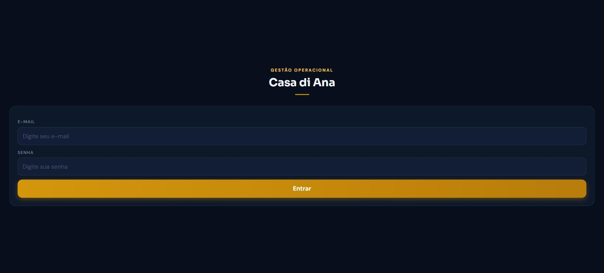
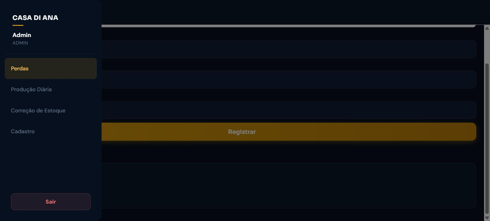
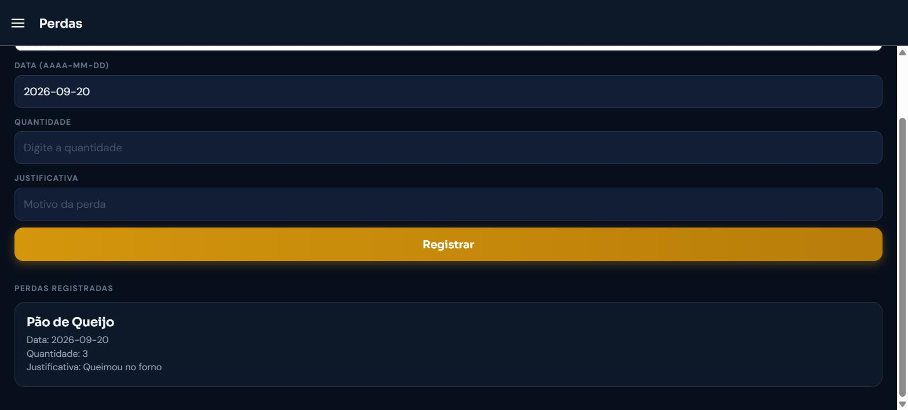
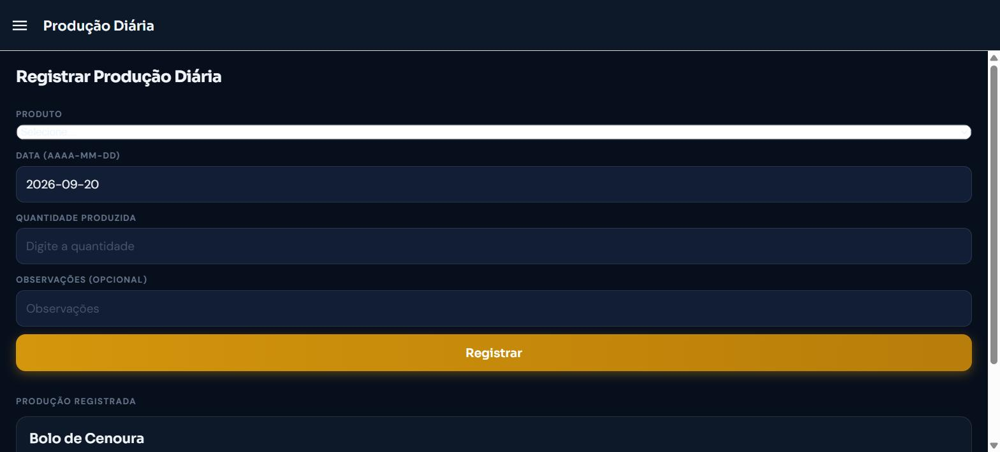
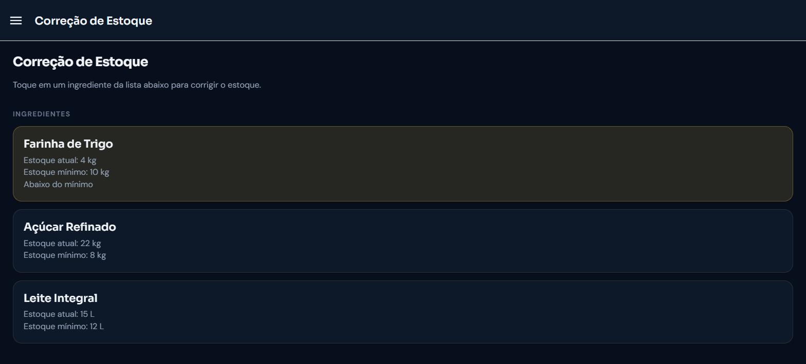
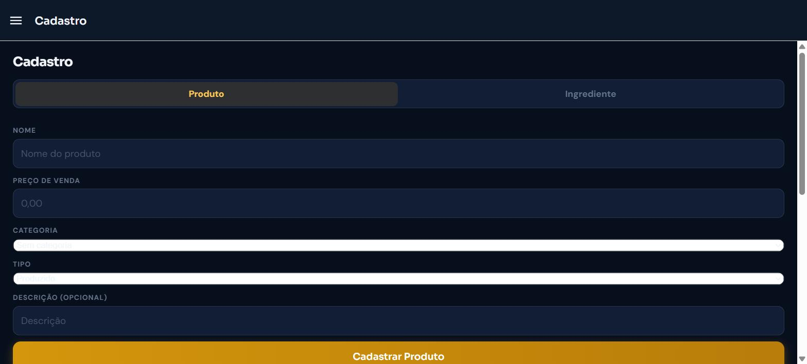
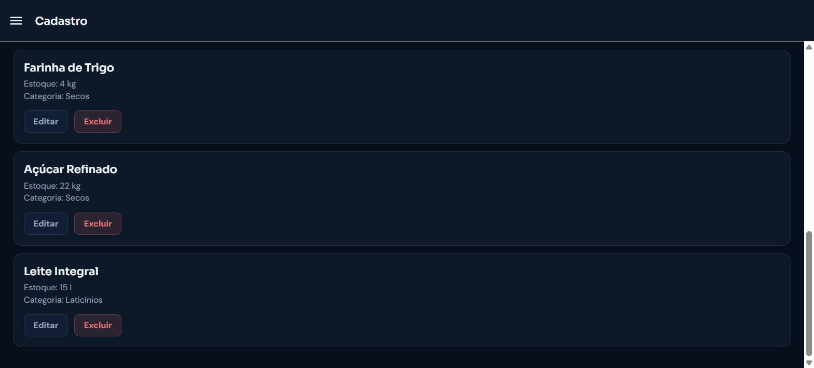

# Casa di Ana Mobile

Aplicativo mobile (Expo / React Native) para o sistema de gestão operacional da cafeteria **Casa di Ana**.

---

## 🎯 Objetivo da aplicação

O sistema de gestão da Casa di Ana já é um ERP completo (estoque, produção, vendas, compras, relatórios), acessado hoje por uma aplicação web. Esse app mobile nasce de uma necessidade real: **os operadores de cozinha, padaria e bar não têm acesso a um computador durante o expediente**, mas precisam registrar perdas, produção e ajustes de estoque no momento em que acontecem.

O objetivo é oferecer um cliente mobile simples que **consome a API REST já existente do sistema** — sem duplicar modelos de dados, regras de negócio ou validações, que continuam centralizadas no backend — permitindo que o operador resolva tarefas do dia a dia direto do celular.

- Repositório do backend consumido: [Projeto_Gestao_Casa_Di_Ana](https://github.com/Gustavoleal1194/Projeto_Gestao_Casa_Di_Ana)
- API em produção: `https://casadiana-api.onrender.com/api`

---

## 🗺️ Funcionalidades previstas para o projeto completo

- Autenticação segura, com suporte à autenticação de dois fatores (2FA), espelhando o fluxo do sistema principal.
- Registro de perdas de produtos.
- Registro de produção diária.
- Correção/ajuste de estoque de ingredientes.
- Cadastro completo (CRUD) de produtos e ingredientes.
- Navegação por menu lateral, com identidade visual alinhada ao sistema web.
- Possíveis extensões futuras, aproveitando endpoints que a API já expõe: registro de vendas diárias, central de notificações de estoque crítico/zerado, consulta de relatórios operacionais.

---

## ✅ Funcionalidades implementadas até o Checkpoint 01

- [x] **Login** com e-mail/senha, consumindo `POST /api/auth/login` da API em produção.
- [x] **Autenticação de dois fatores (2FA)** — fluxo completo de verificação de código via `POST /api/auth/verificar-2fa`, para contas com 2FA habilitado.
- [x] **Sessão persistente** — o token fica salvo no dispositivo; o usuário não precisa logar de novo a cada vez que abre o app.
- [x] **Módulo Perdas** — lista as perdas já registradas e permite registrar uma nova perda de produto (produto, data, quantidade, justificativa).
- [x] **Módulo Produção Diária** — lista a produção registrada e permite registrar produção de um produto (com baixa automática de estoque calculada pela própria API).
- [x] **Módulo Correção de Estoque** — lista os ingredientes (destacando visualmente os que estão abaixo do estoque mínimo) e permite corrigir a quantidade real em estoque de um ingrediente.
- [x] **Módulo Cadastro** — CRUD completo (criar, listar, editar, desativar) de **Produtos** e **Ingredientes**, com seleção de categoria e unidade de medida.
- [x] **Navegação por menu lateral (drawer)**, mostrando nome/papel do usuário logado e opção de logout.
- [x] **Identidade visual** alinhada ao sistema web (paleta em tons de âmbar sobre fundo escuro, tipografia Sora/DM Sans, componentes de card, botão e formulário consistentes).

---

## 🧱 Dificuldades encontradas durante o desenvolvimento

- **CORS ao testar no navegador**: rodar o app em modo web (`expo start --web`) para testes rápidos esbarrava em bloqueio de CORS, já que a API só libera o domínio do frontend web oficial. A solução foi validar as chamadas de API sempre via **Expo Go** em dispositivo real, já que CORS é uma restrição exclusiva de navegador e não existe em runtime nativo.
- **Cold start do plano gratuito do Render**: a API entra em modo de espera quando fica ociosa, e a primeira requisição após um tempo parado pode retornar `503` por alguns segundos até o serviço acordar. Foi necessário aumentar o tempo limite das requisições no app e tratar esse cenário com uma mensagem amigável.

---

# 📦 Checkpoint 02

## 📈 Evolução do projeto

### O que existia no Checkpoint 01
Todas as funcionalidades listadas acima: login com 2FA, sessão persistente, módulos de Perdas, Produção Diária, Correção de Estoque e Cadastro (CRUD de produtos e ingredientes), navegação por menu lateral e identidade visual. As telas já buscavam e exibiam os dados da API, mas **só tratavam o caminho feliz**: não havia indicação de carregamento, e falha de carregamento e lista vazia apareciam iguais na tela.

### O que foi implementado desde a entrega anterior
- **Indicador de carregamento** (`components/Carregando.tsx`) exibido enquanto a busca inicial dos dados está em andamento.
- **Tela de erro de carregamento com "Tentar novamente"** (`components/ErroCarregamento.tsx`), separada da mensagem de lista vazia.
- **Puxar para atualizar** (pull-to-refresh) em todas as listas.
- **Tratamento de respostas sem JSON** do servidor (ex.: página HTML de `503` durante o cold start do Render), com mensagens específicas por status HTTP.
- Atualização do `expo` e do `expo-splash-screen` para as versões recomendadas do SDK 57.

### Funcionalidades alteradas
| Arquivo | Alteração |
|---|---|
| `services/api.ts` | A leitura do JSON passou a ser protegida por `try/catch`; quando o servidor não envia `erros`, a mensagem é gerada a partir do status (401, 403, 404, 502/503/504, 5xx, 4xx). |
| `components/TelaLista.tsx` | Passou a receber `carregando`, `erro` e `aoRecarregar` e decide qual estado exibir: carregando, erro, vazio ou lista. |
| `screens/*Screen.tsx` | Cada tela ganhou estados próprios para o carregamento da lista (`carregandoLista`, `erroLista`), separados dos erros do formulário. |
| `screens/EstoqueScreen.tsx` | Correção: o erro de carregamento só aparecia com um ingrediente selecionado; agora é sempre exibido. |

---

## 🧭 Navegação

### Telas existentes
| Tela | Arquivo | Função |
|---|---|---|
| Login | `screens/LoginScreen.tsx` | E-mail/senha e, se a conta exigir, etapa de código 2FA |
| Perdas | `screens/PerdasScreen.tsx` | Registrar e listar perdas (tela inicial após o login) |
| Produção Diária | `screens/ProducaoScreen.tsx` | Registrar e listar produção |
| Correção de Estoque | `screens/EstoqueScreen.tsx` | Listar ingredientes e corrigir o estoque |
| Cadastro | `screens/CadastroScreen.tsx` | CRUD de produtos e ingredientes (alternância Produto/Ingrediente) — *dividido em três telas no Checkpoint 03* |

### Fluxo de navegação
```
App.tsx
 └─ usuário logado?
     ├─ não → LoginScreen
     │        ├─ requer 2FA → etapa do código (mesma tela)
     │        └─ login OK → área logada
     └─ sim → AppNavigator (Drawer / menu lateral)
               ├─ Perdas (inicial)
               ├─ Produção Diária
               ├─ Correção de Estoque
               ├─ Cadastro
               └─ Sair → limpa a sessão → volta para LoginScreen
```
- A troca entre Login e área logada é feita por **renderização condicional** em `App.tsx`, com base no usuário do `AuthContext`.
- As telas da área logada ficam em um **Drawer Navigator** (`@react-navigation/drawer`), em `navigation/AppNavigator.tsx`.
- Ao abrir o app, a sessão salva no `AsyncStorage` é restaurada e o usuário vai direto para a área logada.

### Transferência de dados entre as telas
- **Contexto global (`context/AuthContext.tsx`)**: o usuário logado (`token`, `nome`, `papel`) é compartilhado com todas as telas via React Context (`useAuth()`). O token é repassado aos services em cada requisição, e o nome/papel aparecem no menu lateral.
- **Sem parâmetros de rota** *(situação do Checkpoint 02 — no Checkpoint 03 o Cadastro passou a usar parâmetros de rota, ver [Navegação atualizada](#-navegação-atualizada))*: cada tela é independente e busca na API os próprios dados ao ser montada, o que garante que sempre exiba a informação atual do servidor.
- **Dentro de cada tela**: os dados passam da tela para os componentes visuais por **props** (`TelaLista`, `Card`, `Selecionador`, `CampoTexto`...).

---

## 🌐 Integração com a WebAPI

### Endereço base
`https://casadiana-api.onrender.com/api` (definido em `services/api.ts`)

Todas as chamadas passam pela função `chamarApi`, que monta a URL, adiciona os cabeçalhos `Content-Type: application/json` e `Authorization: Bearer <token>`, aplica o tempo limite de 30 s e converte a resposta JSON.

### Recursos, endpoints e métodos HTTP
| Recurso | Método | Endpoint | Uso no app | Service |
|---|---|---|---|---|
| Autenticação | `POST` | `/auth/login` | Login com e-mail e senha | `authService` |
| Autenticação | `POST` | `/auth/verificar-2fa` | Validação do código 2FA | `authService` |
| Produtos | `GET` | `/produtos?apenasAtivos=true` | Listar produtos ativos | `produtosService` |
| Produtos | `GET` | `/produtos/{id}` | Obter produto para edição | `produtosService` |
| Produtos | `POST` | `/produtos` | Criar produto | `produtosService` |
| Produtos | `PUT` | `/produtos/{id}` | Atualizar produto | `produtosService` |
| Produtos | `DELETE` | `/produtos/{id}` | Desativar produto | `produtosService` |
| Ingredientes | `GET` | `/ingredientes?apenasAtivos=true` | Listar ingredientes ativos | `ingredientesService` |
| Ingredientes | `GET` | `/ingredientes/{id}` | Obter ingrediente para edição | `ingredientesService` |
| Ingredientes | `POST` | `/ingredientes` | Criar ingrediente | `ingredientesService` |
| Ingredientes | `PUT` | `/ingredientes/{id}` | Atualizar ingrediente | `ingredientesService` |
| Ingredientes | `DELETE` | `/ingredientes/{id}` | Desativar ingrediente | `ingredientesService` |
| Perdas | `GET` | `/perdas` | Listar perdas | `perdasService` |
| Perdas | `POST` | `/perdas` | Registrar perda | `perdasService` |
| Produção diária | `GET` | `/producao-diaria` | Listar produção | `producaoService` |
| Produção diária | `POST` | `/producao-diaria` | Registrar produção | `producaoService` |
| Estoque | `POST` | `/estoque/correcoes` | Corrigir estoque de ingrediente | `estoqueService` |
| Categorias de ingrediente | `GET` | `/categorias?apenasAtivos=true` | Opções do seletor de categoria | `categoriasService` |
| Categorias de produto | `GET` | `/categorias-produto?apenasAtivos=true` | Opções do seletor de categoria | `categoriasService` |
| Unidades de medida | `GET` | `/unidades-medida` | Opções do seletor de unidade | `unidadesMedidaService` |

### Entidades (pasta `models/`)
| Entidade | Principais campos |
|---|---|
| `Produto` / `ProdutoDetalhado` | `id`, `nome`, `precoVenda`, `categoriaNome`, `tipo` (`produzido`/`revenda`), `descricao`, `custoUnitario`, `ativo` |
| `Ingrediente` / `IngredienteDetalhado` | `id`, `nome`, `unidadeMedidaCodigo`, `estoqueAtual`, `estoqueMinimo`, `estoqueMaximo`, `estaBaixoDoMinimo`, `categoriaNome`, `ativo` |
| `Perda` | `id`, `produtoId`, `produtoNome`, `data`, `quantidade`, `justificativa`, `criadoEm` |
| `ProducaoDiaria` | `id`, `produtoId`, `produtoNome`, `data`, `quantidadeProduzida`, `custoTotal`, `observacoes`, `criadoEm` |
| `Categoria` | `id`, `nome`, `ativo` |
| `UnidadeMedida` | `id`, `codigo`, `descricao` |
| `LoginResultado` / `UsuarioLogado` | `requer2Fa`, `tokenTemporario`, `token`, `nome`, `papel` |

### Formato dos dados recebidos
A API responde em **JSON**, sempre no envelope `ApiResponse<T>` (`models/ApiResponse.ts`). Exemplo ilustrativo de `GET /perdas`:

```json
{
  "sucesso": true,
  "dados": [
    {
      "id": "3f2a...",
      "produtoId": "9b1c...",
      "produtoNome": "Pão de queijo",
      "data": "2026-10-20T00:00:00",
      "quantidade": 5,
      "justificativa": "Queimou no forno",
      "criadoEm": "2026-10-20T14:32:10"
    }
  ],
  "erros": []
}
```

Em caso de erro, `sucesso` vem `false` e `erros` traz as mensagens do backend (exemplo ilustrativo):

```json
{ "sucesso": false, "dados": null, "erros": ["Justificativa é obrigatória."] }
```

O `chamarApi` converte a resposta com `resposta.json()`, verifica `sucesso` e devolve para a tela apenas o conteúdo de `dados`, já tipado com a entidade correspondente. Respostas `204 No Content` não têm corpo e retornam vazio.

---

## 🔄 Tratamento de estado

### Armazenamento dos dados recebidos
- Cada tela guarda os dados da API em estados locais com `useState`, tipados pelas entidades (ex.: `useState<Perda[]>([])`, `useState<Produto[]>([])`).
- A busca é feita numa função `async` (`carregarDados`) memorizada com `useCallback` e disparada por `useEffect` quando a tela é montada. Quando a tela precisa de mais de um recurso, as requisições rodam em paralelo com `Promise.all`.
- Depois de criar, editar, excluir ou corrigir um registro, a tela chama `carregarDados` de novo para refletir o estado atual do servidor.
- A sessão do usuário fica no `AuthContext` e é persistida no `AsyncStorage`.

### Controle do carregamento
| Estado | Uso |
|---|---|
| `carregandoLista` | Começa `true`, fica `true` durante a busca e volta a `false` no `finally`. Com a lista vazia, exibe o componente `Carregando` (spinner + "Carregando dados..."); com a lista já preenchida, exibe o indicador de pull-to-refresh. |
| `carregando` | Durante o envio de um formulário, troca o texto do botão para "Registrando..." / "Salvando...". |
| `carregando` (AuthContext) | No login, substitui o botão "Entrar" por um `ActivityIndicator`. |

### Apresentação dos erros ao usuário
| Situação | Mensagem exibida |
|---|---|
| Falha de rede | "Não foi possível conectar à API. Verifique sua conexão." |
| Tempo limite (30 s) | "A API demorou para responder. O servidor pode estar iniciando..." |
| Erro enviado pelo servidor | As mensagens do campo `erros` da API |
| Erro do servidor sem JSON | Mensagem por status, ex.: "Servidor indisponível no momento..." (503), "Erro interno do servidor (500)..." |
| Sessão expirada / sem permissão | Mensagens específicas para 401 e 403 |

- **Erros ao carregar a lista** (`erroLista`) aparecem no componente `ErroCarregamento`, em destaque vermelho e com o botão **"Tentar novamente"**. Se a lista já tinha dados, o aviso aparece acima dela.
- **Erros de formulário** (`erro`), como validação de campos e falha ao salvar, aparecem no componente `MensagemErro`, logo acima do botão de envio.
- **API sem registros**: o componente `ListaVazia` exibe uma mensagem específica de cada tela (ex.: "Nenhuma perda registrada"), diferente da mensagem de erro.

---

# 🏁 Checkpoint 03 — Entrega final

## 📈 Evolução do projeto

### O que existia no Checkpoint 02
Todas as funcionalidades do Checkpoint 01, mais indicação de carregamento, tela de erro com "Tentar novamente", pull-to-refresh e tratamento de respostas sem JSON. Faltavam: transferência de parâmetros entre telas e botão de voltar, confirmação visual das ações concluídas, validação de números/datas digitados de forma inválida e tratamento da sessão expirada.

### O que foi implementado desde a entrega anterior
- **Navegação em pilha no Cadastro** — a tela única de Cadastro virou três telas (lista → detalhe → formulário), com o `id` e o `tipo` do item passados como **parâmetros de rota** e botão **voltar** no topo (e no botão voltar do Android).
- **Tela de detalhes** do produto/ingrediente, com todos os campos retornados por `GET /produtos/{id}` e `GET /ingredientes/{id}` e as ações Editar e Excluir.
- **Botão "Novo produto"/"Novo ingrediente"** que abre o mesmo formulário usado na edição.
- **Mensagens de sucesso** (`components/MensagemSucesso.tsx`) após registrar, salvar, corrigir e excluir; somem sozinhas após 4 s.
- **Validação de números e datas** (`utils/validacao.ts`) com mensagens específicas por campo, coberta por testes automatizados (`npm test`).
- **Sessão expirada (401)**: o app encerra a sessão, volta para o Login e exibe "Sua sessão expirou. Faça login novamente.".
- **Restauração da sessão** sem "piscar" a tela de Login ao abrir o app.

### Arquivos criados e alterados
| Arquivo | Alteração |
|---|---|
| `navigation/CadastroNavigator.tsx` | **Novo.** Stack nativo (`@react-navigation/native-stack`) aninhado na rota Cadastro do drawer |
| `navigation/tipos.ts` | **Novo.** Tipagem das rotas e de seus parâmetros (`CadastroStackParamList`) |
| `screens/CadastroListaScreen.tsx` | **Novo.** Lista de produtos/ingredientes, botão "Novo", recebe a mensagem de sucesso por parâmetro |
| `screens/CadastroDetalheScreen.tsx` | **Novo.** Detalhes do item recebido por parâmetro; Editar e Excluir |
| `screens/CadastroFormularioScreen.tsx` | **Novo.** Formulário único de criação/edição (com `id` = editar, sem `id` = criar) |
| `screens/CadastroScreen.tsx` | **Removido** (substituído pelas três telas acima) |
| `components/MensagemSucesso.tsx` | **Novo.** Feedback visual de ação concluída |
| `utils/validacao.ts` / `utils/validacao.test.mts` | **Novos.** `converterNumero` e `dataValida`, com testes |
| `screens/PerdasScreen.tsx`, `ProducaoScreen.tsx`, `EstoqueScreen.tsx` | Mensagem de sucesso e validação por campo |
| `services/api.ts` | `definirAoSessaoExpirar`: avisa o app quando uma chamada autenticada recebe 401 |
| `context/AuthContext.tsx` | Encerra a sessão no 401 e expõe `restaurando` |
| `App.tsx` | Mostra "Restaurando sessão..." enquanto lê o AsyncStorage |
| `navigation/AppNavigator.tsx` | Rota Cadastro aponta para o `CadastroNavigator` |

## 🧭 Navegação atualizada

```
App.tsx
 └─ restaurando sessão? → "Restaurando sessão..."
 └─ usuário logado?
     ├─ não → LoginScreen (e-mail/senha → código 2FA, se exigido)
     └─ sim → AppNavigator (Drawer / menu lateral)
               ├─ Perdas (inicial)
               ├─ Produção Diária
               ├─ Correção de Estoque
               ├─ Cadastro → CadastroNavigator (Stack)
               │     ├─ CadastroLista ──toque no item──▶ CadastroDetalhe { tipo, id }
               │     │      └─ "Novo …" ─────────────▶ CadastroFormulario { tipo }
               │     └─ CadastroDetalhe ──"Editar"───▶ CadastroFormulario { tipo, id }
               └─ Sair → limpa a sessão → LoginScreen
```

### Parâmetros de rota
| Rota | Parâmetros | Quem envia | Uso |
|---|---|---|---|
| `CadastroDetalhe` | `tipo`, `id` | Lista (toque no card) | Busca o item na API pelo `id` |
| `CadastroDetalhe` | `mensagem` | Formulário (após editar) | Exibe "Alterações salvas com sucesso!" |
| `CadastroFormulario` | `tipo`, `id?` | Lista ("Novo") / Detalhe ("Editar") | Sem `id` cria; com `id` carrega e atualiza |
| `CadastroLista` | `mensagem` | Formulário (após criar) / Detalhe (após excluir) | Exibe a confirmação da ação |

### Retorno às telas anteriores
- Seta **voltar** no cabeçalho e botão voltar do Android desempilham Formulário → Detalhe → Lista.
- Botões **Cancelar** (formulário) e **Voltar** (telas de erro) chamam `navigation.goBack()`.
- Após salvar ou excluir, `navigation.popTo(...)` volta para a tela certa já levando a mensagem de sucesso; a tela que recebe recarrega os dados ao ganhar foco (`useFocusEffect`).
- No topo da lista do Cadastro, o ícone de menu abre o drawer para ir às outras telas.

## ✅ Feedback e validação

| Ação | Mensagem de sucesso |
|---|---|
| Registrar perda / produção | "Perda registrada com sucesso!" / "Produção registrada com sucesso!" |
| Corrigir estoque | "Estoque de *ingrediente* corrigido com sucesso!" |
| Cadastrar produto/ingrediente | "Produto "*nome*" cadastrado com sucesso!" |
| Editar | "Alterações salvas com sucesso!" |
| Excluir | "Produto "*nome*" excluído com sucesso!" |

| Validação | Mensagem |
|---|---|
| Produto não selecionado | "Selecione um produto." |
| Data fora de AAAA-MM-DD ou inexistente (ex.: 2026-02-30) | "Data inválida. Use o formato AAAA-MM-DD." |
| Quantidade vazia, não numérica ou ≤ 0 | "Informe uma quantidade válida maior que zero." |
| Preço de venda inválido | "Informe um preço de venda válido maior que zero." |
| Estoque máximo menor que o mínimo | "O estoque máximo deve ser um número maior ou igual ao mínimo." |
| Sessão expirada (401) | "Sua sessão expirou. Faça login novamente." (na tela de Login) |

Os erros de validação do servidor (campo `erros` da API) continuam sendo exibidos como antes.

## 🧪 Testes e verificação

Verificações automatizadas executadas antes da entrega (todas aprovadas):

| Verificação | Comando | Resultado |
|---|---|---|
| Testes unitários das validações | `npm test` | 4/4 aprovados |
| Checagem de tipos (TypeScript strict) | `npx tsc --noEmit` | Sem erros |
| Saúde do projeto Expo (dependências e config do SDK 58) | `npx expo-doctor` | 20/20 checagens aprovadas |
| Geração do bundle Android | `npx expo export --platform android` | Bundle gerado sem erros |
| WebAPI em produção acessível | `GET /api/produtos` sem token | `401` (rota protegida respondendo) |
| Login com credenciais inválidas | `POST /api/auth/login` | `401` com `"erros": ["Credenciais inválidas."]` |

Casos cobertos pelos testes unitários (`utils/validacao.test.mts`):

- `converterNumero` aceita `2,5`, `2.5` e ` 10 `, e rejeita vazio, `abc`, `1.2.3`, `2,5kg`, `Infinity`, `1e3` e `0x10`.
- `dataValida` aceita `2026-10-22` e `2024-02-29` (ano bissexto), e rejeita `22/10/2026`, `2026-2-1`, `2026-02-30` e `2025-02-29`.

Roteiro de teste manual no **Expo Go**:

1. Login (com 2FA, se habilitado) e reabertura do app: a sessão é restaurada sem piscar a tela de Login.
2. Cadastro → tocar em um item → Detalhes → Editar → Salvar: volta aos Detalhes com "Alterações salvas com sucesso!".
3. Cadastro → Novo produto → Salvar: volta à lista com a mensagem de cadastro.
4. Detalhes → Excluir → confirmar: volta à lista com a mensagem de exclusão.
5. Voltar pela seta do cabeçalho e pelo botão voltar do Android em cada tela da pilha.
6. Perdas com quantidade `abc` e com data `2026-02-30`: mensagens de validação específicas.
7. Modo avião ao abrir uma lista: mensagem de falha de conexão com botão "Tentar novamente".

---

## 🔗 Repositórios

- **App mobile (este projeto):** https://github.com/Gustavoleal1194/GestaoCasaDiAna_Mobile
- **Backend / API consumida:** https://github.com/Gustavoleal1194/Projeto_Gestao_Casa_Di_Ana

---

## 📱 Capturas de tela

*Dados exibidos são ilustrativos, para fins de demonstração da interface.*

<table>
  <tr>
    <td align="center">
      <br>
      <sub>Login (com suporte a 2FA)</sub>
    </td>
    <td align="center">
      <br>
      <sub>Menu lateral</sub>
    </td>
  </tr>
  <tr>
    <td align="center">
      <br>
      <sub>Registrar Perda</sub>
    </td>
    <td align="center">
      <br>
      <sub>Produção Diária</sub>
    </td>
  </tr>
  <tr>
    <td align="center">
      <br>
      <sub>Correção de Estoque</sub>
    </td>
    <td align="center">
      <br>
      <sub>Cadastro — Produto</sub>
    </td>
  </tr>
  <tr>
    <td align="center" colspan="2">
      <br>
      <sub>Cadastro — Ingrediente (Editar/Excluir)</sub>
    </td>
  </tr>
</table>

---

## ⚙️ Tecnologias

| Tecnologia | Uso |
|---|---|
| Expo SDK 58 / React Native 0.88 | Framework mobile |
| TypeScript | Tipagem estática |
| React Navigation (Drawer + Native Stack) | Menu lateral e navegação em pilha com parâmetros |
| AsyncStorage | Persistência da sessão no dispositivo |
| expo-linear-gradient | Botões com gradiente (identidade visual) |
| @expo-google-fonts (Sora, DM Sans) | Tipografia alinhada ao sistema web |

---

## 🚀 Como executar

O app consome por padrão a **API já publicada** em `https://casadiana-api.onrender.com/api` (backend .NET 8 + PostgreSQL 15 hospedados no Render). Para testar o app **não é preciso** rodar a API nem o banco localmente; as seções 2 e 3 explicam como fazê-lo, se desejado.

### 1. Aplicação mobile

Pré-requisitos: Node.js 22.18+ (os testes usam o suporte nativo do Node a TypeScript) e o app **Expo Go** (SDK 58) no celular.

```bash
npm install
npm start      # inicia o Expo e exibe o QR code
npm test       # testes automatizados das validações
```

No **iPhone físico**, o Expo Go (SDK 58) exige que o app e o Expo CLI estejam logados na **mesma conta Expo**. Antes de iniciar, faça login no CLI com a mesma conta usada no Expo Go:

```bash
npx expo login
npx expo whoami   # confere a conta logada
```

No Android (dispositivo ou emulador) esse login não é necessário.

Escaneie o QR code exibido no terminal com o app **Expo Go** (Android/iOS), estando o celular na mesma rede Wi-Fi do computador. Se preferir, no Expo Go use **"Enter URL manually"** e informe `exp://<IP-do-computador>:8081`.

O app já aponta para a API em produção (`https://casadiana-api.onrender.com/api`) — não é necessário rodar o backend localmente para testar. A primeira requisição após um tempo parado pode levar alguns segundos (cold start do Render); o app exibe uma mensagem e o botão "Tentar novamente".

> O modo web (`npm run web`) não consegue chamar a API por bloqueio de **CORS**; use sempre o Expo Go.

### 2. WebAPI

Código-fonte: [Projeto_Gestao_Casa_Di_Ana](https://github.com/Gustavoleal1194/Projeto_Gestao_Casa_Di_Ana) (ASP.NET Core 8, Clean Architecture). Pré-requisitos: .NET SDK 8.0 e PostgreSQL 15 (ou Docker).

**Opção A — Docker Compose (sobe API, banco e frontend web):**
```bash
git clone https://github.com/Gustavoleal1194/Projeto_Gestao_Casa_Di_Ana.git
cd Projeto_Gestao_Casa_Di_Ana/CasaDiAna
cp .env.example .env   # preencha POSTGRES_PASSWORD e JWT_CHAVE (mín. 32 caracteres)
docker-compose up --build
# API/Swagger: http://localhost:8080/swagger
```

**Opção B — Execução local:**
```bash
cd Projeto_Gestao_Casa_Di_Ana/CasaDiAna
# variáveis de ambiente (ou appsettings.Development.json):
#   ConnectionStrings__Default=Host=localhost;Port=5432;Database=casadiana;Username=postgres;Password=sua_senha
#   Jwt__Chave=chave-secreta-com-no-minimo-32-caracteres
dotnet run --project src/CasaDiAna.API
# API: http://localhost:5130
```

Para o app usar a API local, altere `URL_BASE` em `services/api.ts` para `http://<IP-do-computador>:<porta>/api` (o celular não enxerga `localhost` do computador; ambos devem estar na mesma rede).

### 3. Banco de dados

- **SGBD:** PostgreSQL 15, acessado pela API via Entity Framework Core 8 (Npgsql). O app mobile **não** acessa o banco diretamente — tudo passa pela API.
- **Criação do schema:** as **migrations são aplicadas automaticamente** quando a API inicia; basta criar o banco vazio (`CREATE DATABASE casadiana;`) e apontar a connection string. No Docker Compose o container do PostgreSQL já é criado.
- **Usuário inicial:** com o banco vazio, a API cria `admin@casadiana.com` / `Admin@123` (papel Admin), que pode ser usado no login do app.

### 4. Demonstração no computador

A apresentação é feita com o app rodando no **Expo Go** do celular. Para exibir a tela do celular no computador, espelhe o dispositivo (no Android, por exemplo, com [`scrcpy`](https://github.com/Genymobile/scrcpy) via USB).
